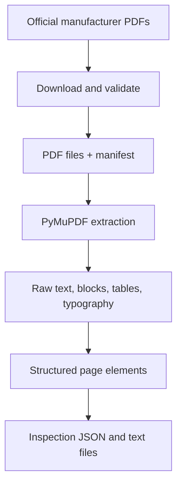
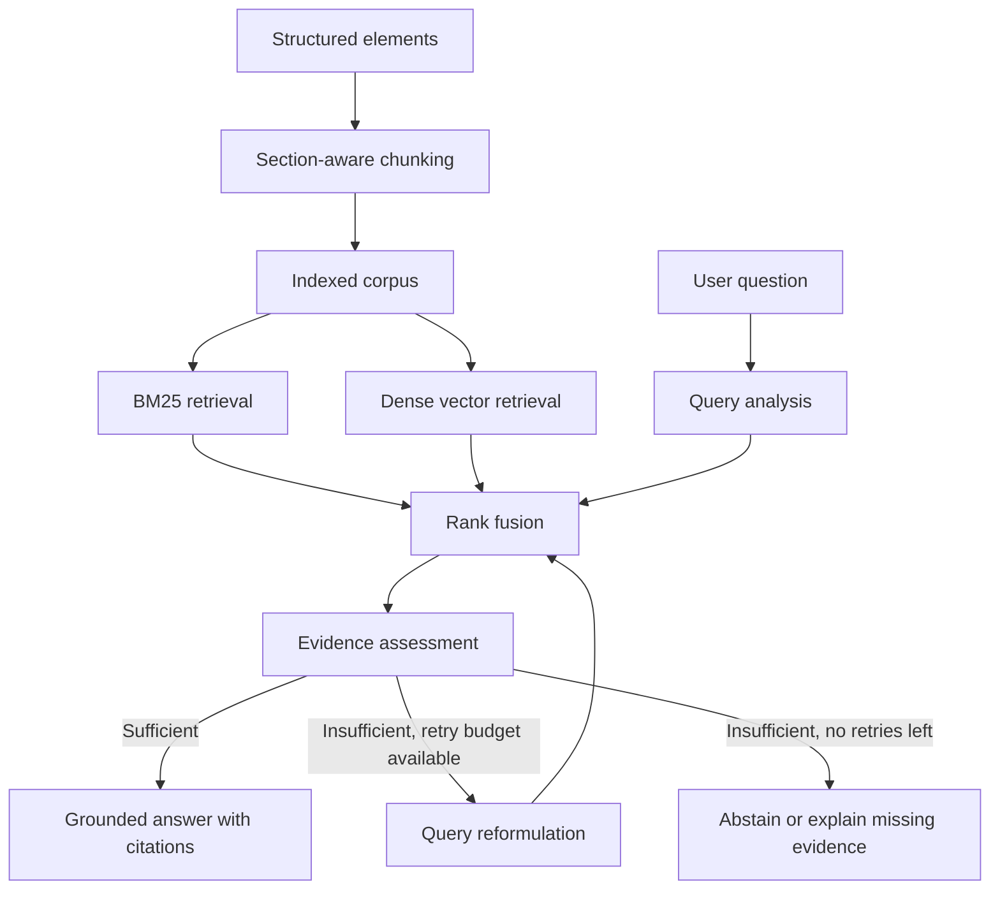

# Tech Specs Agent

**A technical-document assistant built around Retrieval-Augmented Generation (RAG) and agentic workflows.**

Tech Specs Agent is a Python project for querying hardware documentation, including microcontroller datasheets, reference manuals, and register descriptions. The goal is to produce answers grounded in manufacturer documentation, with traceable page references, while studying how document parsing and retrieval choices affect answer quality.

> **Project status — in development:** PDF collection and initial structured extraction are implemented. Chunking, search, LLM-based answers, agent workflows, and quantitative evaluation are planned; they are **not yet implemented**.

## Why this project?

Technical PDFs are challenging knowledge sources. They contain dense tables, register maps, part numbers, multi-column layouts, footers, and figures that do not always parse correctly as text. A useful RAG application must preserve relationships such as **register → address → function**, not just extract words from a page.

This project explores that problem using real microcontroller documentation. It aims to compare keyword search, semantic search, hybrid retrieval, and agent-assisted query refinement using measurable evaluation criteria.

## Current capabilities

- **Reproducible PDF collection:** download manufacturer datasheets, validate that they open as PDFs, and record file size, page count, SHA-256 hash, source URL, and (for new downloads) a download timestamp in a manifest.
- **PDF inspection:** extract raw text, position-sorted text, text blocks with bounding boxes, and a sample of typography metadata using PyMuPDF.
- **Table extraction:** detect conventional tables, serialize them as Markdown, and filter known footer-like false positives.
- **Structured page elements:** represent text and detected tables with a document ID, page number, content type, bounding box, and element ID.
- **Initial deduplication:** avoid re-indexing words that fall inside the bounding boxes of accepted multi-row tables. Potentially incomplete one-row tables retain surrounding text for review.

The current pipeline is a **parsing prototype**, not yet a working RAG assistant.

## Documents used

| Document | Manufacturer | Why it is useful |
| --- | --- | --- |
| [STM32L432KC datasheet](https://www.st.com/resource/en/datasheet/stm32l432kc.pdf) | STMicroelectronics | Conventional tables for timers, peripherals, pinout, and electrical specifications |
| [ATtiny25/45/85 datasheet](https://ww1.microchip.com/downloads/en/DeviceDoc/atmel-2586-avr-8-bit-microcontroller-attiny25-attiny45-attiny85_datasheet.pdf) | Microchip | Register maps and diagrams with less conventional layouts |

The PDFs are downloaded from the manufacturers rather than committed to this repository.

## Architecture

### Implemented: collection and parsing



### Planned: retrieval and agentic answering



The planned agent will use **LangGraph** for explicit state transitions and bounded retries. The retrieval layer is expected to use **BM25 + embeddings + reciprocal rank fusion**, with **Qdrant** as the leading vector-database option. These are design intentions, not current dependencies.

## Repository structure

```text
tech-specs-agent/
├── data/
│   ├── raw/                       # Downloaded PDFs (gitignored)
│   ├── processed/                 # Inspection outputs (gitignored)
│   └── manifest.json             # Document metadata and hashes
├── scripts/
│   ├── download_docs.py          # Download and validate PDFs
│   └── inspect_pdf.py            # Inspect extracted page content
├── src/
│   └── tech_specs/
│       ├── __init__.py
│       ├── ingestion.py          # Read PDF pages and detect tables
│       └── structure.py          # Build structured page elements
├── .gitignore
├── pyproject.toml
└── README.md
```

Some directories and files in the **planned** roadmap (such as `chunking.py`, `retrieval.py`, `agent.py`, and `tests/`) will be added as those features are implemented.

## Getting started

### Requirements

- Python **3.11+** (Python 3.12 recommended)
- Git
- Internet connection for the initial PDF download

### 1. Clone the repository

```powershell
git clone <YOUR_REPOSITORY_URL>
cd tech-specs-agent
```

Replace `<YOUR_REPOSITORY_URL>` with the actual repository URL once the project is published. If working in an existing local directory, skip this step.

### 2. Create and activate a virtual environment

**Windows / PowerShell:**

```powershell
py -3.12 -m venv .venv
.\.venv\Scripts\Activate.ps1
```

**Linux / macOS:**

```bash
python3 -m venv .venv
source .venv/bin/activate
```

### 3. Install the project

```bash
python -m pip install -e .
```

This installs the Python package in editable mode, using the dependencies defined in `pyproject.toml`.

### 4. Download the datasheets

```bash
python scripts/download_docs.py
```

The script saves the original PDFs under `data/raw/` and records their metadata in `data/manifest.json`. Valid existing PDF files are skipped. If a manufacturer server times out, rerunning the script is a valid workaround; automatic retries are not yet implemented.

### 5. Inspect a PDF page

```bash
python scripts/inspect_pdf.py stm32l432kc --page 38
python scripts/inspect_pdf.py attiny85 --page 9
python scripts/inspect_pdf.py attiny85 --page 10
```

`--page` uses the **1-based PDF page index**. The inspection script writes files to `data/processed/inspections/`:

- `<document>_p<page>.json` — extraction data and structured elements
- `<document>_p<page>_raw.txt` — raw text extraction
- `<document>_p<page>_sorted.txt` — position-sorted text extraction

## Known limitations

- **Table extraction is not universally reliable.** Borderless tables, register maps, and diagrams may be incomplete or incorrectly structured.
- **Deduplication is heuristic.** It relies on word centers and table bounding boxes; it needs automated regression tests before being treated as robust.
- **Reading order is approximate.** Spatial sorting alone can fail for multi-column layouts.
- **Headers, footers, and section titles require further refinement.** Current filters are tailored to observed documents.
- **Images and figures are not interpreted semantically.** Their embedded text may be extracted, but graphical relationships are not reconstructed.
- **There is no retrieval or LLM inference yet.** Answers, citations, hybrid ranking, and agent decisions cannot currently be demonstrated.

## Roadmap

- [x] Initialize Python package and repository structure
- [x] Download and validate official PDF documents
- [x] Extract text, typography samples, and conventional tables
- [x] Create an initial structured element representation
- [ ] Add automated regression tests for known PDF pages
- [ ] Improve section identification, ordering, and table/text deduplication
- [ ] Implement section-aware chunking and export `chunks.jsonl`
- [ ] Implement BM25, semantic retrieval, and hybrid rank fusion
- [ ] Add LLM-grounded answering with document/page citations
- [ ] Implement bounded query refinement with LangGraph
- [ ] Create an evaluation dataset and compare retrieval strategies
- [ ] Add a Streamlit interface and reproducible deployment

## Evaluation plan

A small, manually checked benchmark of technical questions will be used to evaluate retrieval and answers. Planned metrics include:

- **Recall@K:** whether relevant evidence appears among the top K retrieved results
- **MRR:** ranking of the first relevant result
- **Answer accuracy:** correctness against a verified reference answer
- **Citation accuracy:** whether cited evidence supports the answer
- **Latency:** response time of each retrieval/agent configuration

No performance or accuracy improvements are claimed until these measurements have been run.

## Tech stack

**Currently used:** Python, PyMuPDF, Requests, JSON, SHA-256, Git.

**Planned / under consideration:** Qdrant, BM25, sentence-transformer embeddings, LangGraph, an LLM provider or local model, pytest, Streamlit, Docker.

## License

A project license has not yet been selected. Manufacturer datasheets remain subject to their respective publishers' terms.
