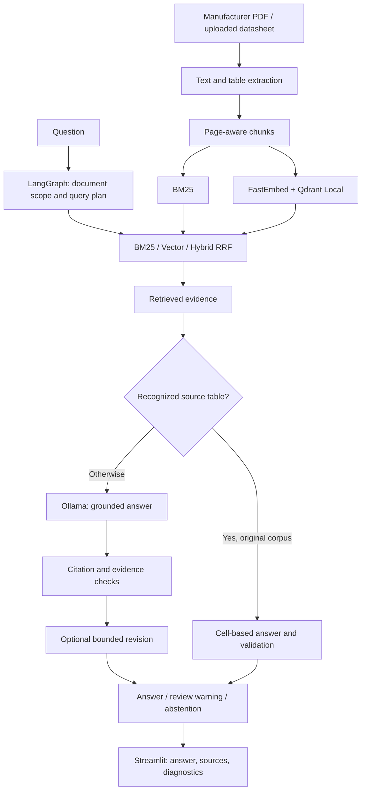

# Tech-Specs Agent

**A local, evidence-grounded RAG assistant for microcontroller datasheets.**

Tech-Specs Agent lets you ask technical questions about hardware documentation and inspect the PDF passages used to answer them. It combines keyword and semantic retrieval, a LangGraph workflow, a local language model, and explicit citation checks. A Streamlit interface supports the original benchmark documents and additional user-imported datasheets.

The application runs locally with **Ollama**.

## Features

- **Multiple retrieval strategies:** BM25, dense vector search (FastEmbed + Qdrant Local), and hybrid retrieval using Reciprocal Rank Fusion (RRF).
- **Agent workflow:** document selection, query planning, evidence retrieval, answer generation, citation validation, and bounded review/repair using LangGraph.
- **Traceable answers:** chunk IDs, PDF page numbers, retrieved passages, and downloadable JSON diagnostics. Unsupported answers may be withheld; uncertain coverage is labeled rather than silently accepted.
- **Source-table verification:** for recognized tables in the original ATtiny/STM32 corpus, selected answers can be reconstructed from extracted cells and checked without LLM rewriting.
- **Additional datasheets:** import text-based PDF files through the web UI. New documents are isolated from the original benchmark; BM25 is available after import, with vector/hybrid search after indexing.
- **Local-first:** PDFs, indexes, and model inference stay on the user's computer.

## Architecture



**Main stack:** Python, PyMuPDF, rank-bm25, FastEmbed, Qdrant Local, LangGraph, Ollama (Qwen3 4B by default), Streamlit, and pytest.

## Getting started

### Requirements

- Python **3.12** recommended
- Git and an internet connection for the initial installation, model download, and official PDFs
- [Ollama](https://ollama.com/download) installed and running locally
- Enough RAM/disk space to run a quantized local model and store the vector indexes; GPU acceleration is optional

The commands below use **Windows PowerShell** and assume you are in the repository root.

### 1. Install dependencies

```powershell
py -3.12 -m venv .venv
.\.venv\Scripts\Activate.ps1
python -m pip install --upgrade pip
python -m pip install -e ".[dev,retrieval,vectors,agent]"
python -m pip install streamlit
```

The optional dependency groups above are the groups used during development. If you change `pyproject.toml`, update this command accordingly.

### 2. Start the local model

```powershell
ollama pull qwen3:4b
ollama list
```

Keep the Ollama application running. The app uses its local server (normally `127.0.0.1:11434`); it does not require an OpenAI or Anthropic API key.

### 3. Prepare the original datasheets

The original evaluation corpus covers:

- [STM32L432KC — STMicroelectronics](https://www.st.com/resource/en/datasheet/stm32l432kc.pdf)
- [ATtiny25/45/85 — Microchip](https://ww1.microchip.com/downloads/en/DeviceDoc/atmel-2586-avr-8-bit-microcontroller-attiny25-attiny45-attiny85_datasheet.pdf)

Download the PDFs and build the search corpus:

```powershell
python scripts/download_docs.py
python scripts/build_corpus.py
python scripts/index_vectors.py
```

The last command creates the original Qdrant Local index. **BM25 only needs the corpus**, so you may skip vector indexing if you intend to use BM25 exclusively. The initial embedding download can take some time. Close any other process using the same Qdrant Local directory before rebuilding its index.

If the corpus and vector index already exist on your computer, you can skip this step.

### 4. Launch the web application

```powershell
python -m streamlit run scripts/web_app.py --server.address 127.0.0.1
```

Open **http://127.0.0.1:8501** (or the port shown by Streamlit).

## Using the application

1. Select **Auto-detect** for the two original documents, or explicitly select a datasheet in the sidebar.
2. Choose **BM25**, **Vector**, or **Hybrid (RRF)**. Vector and Hybrid require a built index.
3. Ask a question in English and review the response alongside **Sources and PDF pages**.
4. Open **Agent diagnostics** to inspect the query plan, checks, and any revision attempts. Download the JSON report when investigating a result.

Example questions:

```text
What is TIM2 counter resolution on STM32L432KC?
How does programming the WDTON fuse affect the watchdog on ATtiny25/45/85?
Can STM32L432xx timers trigger ADC/DAC conversions in Stop 2?
```

### Import a new datasheet

In the sidebar, choose **Add a PDF datasheet → Import PDF**, then select the imported document. BM25 can query it immediately. To enable semantic or hybrid search, click **Build vector index** for that document.

The PDF, extracted chunks, and optional Qdrant index are stored independently under `data/user_docs/<document_id>/`. These files are local and excluded from Git. 

**Current scope:** imported documents use a generic *single-document* retrieval plan. The specialized source-table extraction rules used for the original corpus are not applied to arbitrary new PDFs. Automatic comparison across multiple imported PDFs is not implemented.

## Evaluation

The project includes a **30-question benchmark** created for the original two datasheets: **18 development questions** and **12 held-out questions**. Development experiments compared BM25, vector, and hybrid retrieval, as well as answer generation and local evidence checks.

Relevant measurements include **Hit@K, Recall@K, MRR, nDCG@K**, citation validity, answer completeness, and the number of answers withheld for review. The project also records local agent decisions to enable manual inspection.

The latest development runs evaluated both BM25 and Hybrid on all 18 development questions. They demonstrate that citation checks and deterministic table extraction can work, but also expose false coverage warnings, incomplete multi-evidence answers, and occasional unsupported model claims. **A locally checked answer is not a guarantee of technical correctness.** The reserved questions should not be used for prompt or retrieval tuning.

Reproduce the test suite with:

```powershell
python -m pytest -q
```

To run the guarded agent's *development* evaluation (requires the original corpus, indexes where applicable, and Ollama):

```powershell
python scripts/evaluate_verified_dev.py --method bm25
python scripts/evaluate_verified_dev.py --method hybrid
```

These commands save run reports locally under `data/processed/`; they do not constitute an independent accuracy audit.

## Repository layout

```text
tech-specs-agent/
├── src/tech_specs/          # Parsing, retrieval, LangGraph, verification, PDF import
├── scripts/
│   ├── web_app.py           # Streamlit application
│   ├── download_docs.py     # Original manufacturer PDFs
│   ├── build_corpus.py      # Original searchable corpus
│   ├── index_vectors.py     # Original vector index
│   └── ...                  # Evaluation, inspection, and CLI utilities
├── tests/                   # Automated tests
├── evaluation/              # Benchmark questions and reference judgments
├── data/                    # PDFs, chunks, indexes, run outputs (mostly gitignored)
├── pyproject.toml
├── .gitignore
└── README.md
```

## Limitations

- Complex PDF layouts, figures, and borderless tables may not be reconstructed accurately. Imported PDFs must contain extractable text; OCR is not implemented.
- The verifier checks citation IDs and can judge local evidence, but an LLM judge can be wrong. Some correct answers are flagged for review, and some generated answers are withheld.
- The original source-table rules cover recognized patterns, **not all tables or devices**.
- Imported documents are searched one at a time; the app is not designed for public deployment or concurrent users without additional security and infrastructure.
- Inference latency depends on the local hardware and model size.

## Data and attribution

Datasheets belong to their respective manufacturers and are **not distributed in this repository**. Use the official links above to obtain the source PDFs. Local runs may download third-party model weights and embedding models under their own licenses.
